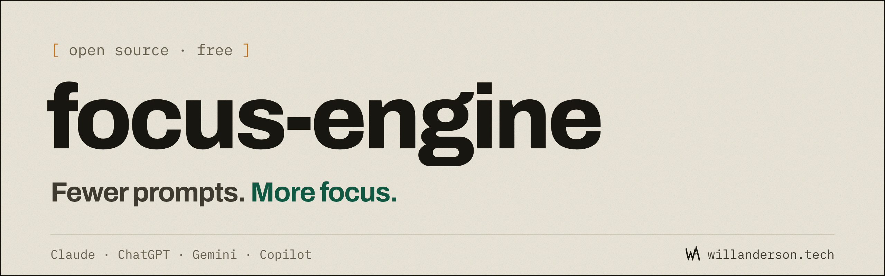
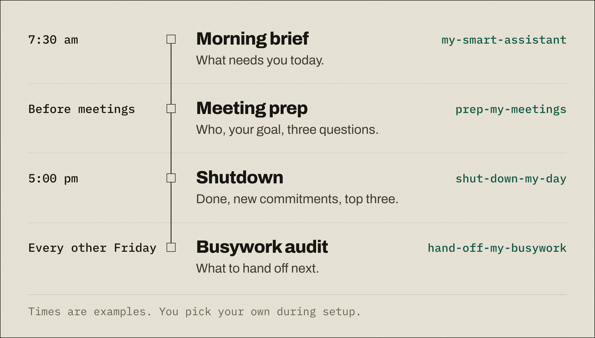
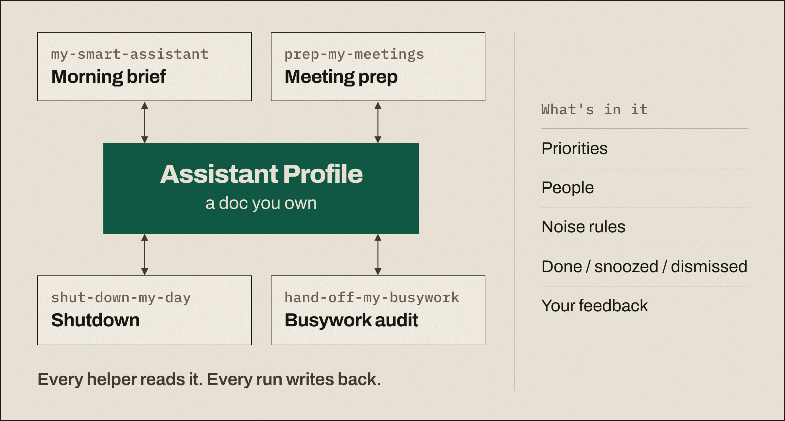
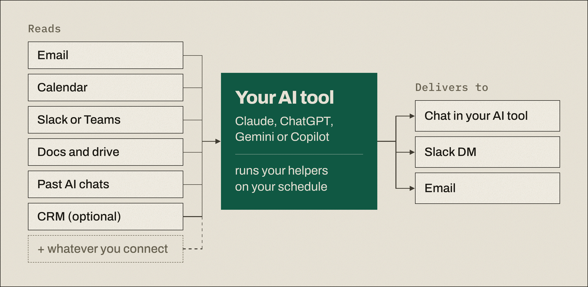

<a href="https://willanderson.tech/focus-engine">
  <picture>
    <source media="(prefers-color-scheme: dark)" srcset="docs/images/header-dark.png">
    <source media="(prefers-color-scheme: light)" srcset="docs/images/header-light.png">
    
  </picture>
</a>

One setup prompt that builds you an AI chief of staff: helpers that bring you what needs your attention, checked and short, so you stop typing "catch me up on everything" every morning.

The helpers are a morning brief, meeting prep, an end-of-day shutdown and a busywork audit. They run on your schedule inside the AI tool you already use, read only what you connect, and check every item against its source.

You run it once. It checks what your AI tool and plan can do, interviews you (starting from what it already knows about you), writes the helpers you choose, test-drives them on your real data, and schedules them.

Status: v0.1 beta. Free and open source (MIT).

## Get started

1. **Copy or download the setup prompt** from [willanderson.tech/focus-engine](https://willanderson.tech/focus-engine#start). The page has a copy button, or grab the file directly: [`focus-engine-setup.md`](https://willanderson.tech/focus-engine/focus-engine-setup.md).
2. **Paste or attach it in a new chat** in Claude, ChatGPT, Gemini or Microsoft 365 Copilot. If the chat box won't take it, attach the downloaded file.
3. **Say "build my focus engine"** and answer its questions. Short answers are fine. Allow 20 to 30 minutes; you can stop and finish later.

On Claude and prefer a skill? Download [`build-my-focus-engine.zip`](https://willanderson.tech/focus-engine/build-my-focus-engine.zip), then go to Customize → Skills → + → Create skill → Upload a skill. The prompt and the ZIP are built from this repo (`npm run build`), so they always match the source here.

## What you get

Up to four helpers. You pick which ones run, when, and where they show up.

| Helper | What it brings you | Default schedule |
| --- | --- | --- |
| `my-smart-assistant` | **Morning brief.** What needs you today (seven items, tops), what you're waiting on, and what's coming up. | Weekday mornings; most people pick 7:30 |
| `prep-my-meetings` | **Meeting prep.** A short card for the meetings that matter: who, what's open between you, your goal, three questions. | Folded into the morning brief, for external meetings and VIPs |
| `shut-down-my-day` | **End-of-day shutdown.** What got done, what you promised, and tomorrow's top three, so tomorrow's brief starts accurate. | 30 minutes before your day ends |
| `hand-off-my-busywork` | **Busywork audit.** Every two weeks: what you keep doing by hand, ranked by time saved. Then it builds the top one with you. | Every two weeks, plus on demand |

<picture>
  <source media="(prefers-color-scheme: dark)" srcset="docs/images/helpers-day-dark.png">
  <source media="(prefers-color-scheme: light)" srcset="docs/images/helpers-day-light.png">
  
</picture>

Every generated helper names your real sources, people, priorities, channel and times, with no placeholders or sample text left in.

## How it works

### One Profile, a doc you own

All four helpers share one **Assistant Profile**, a doc in your own drive (Google Docs, Notion, OneDrive or Word, or a local file if nothing else works). It holds your priorities, people, noise rules, and a record of what's done, snoozed or dismissed. Every helper reads it at the start of a run and writes back at the end. You can read and edit it anytime.

<picture>
  <source media="(prefers-color-scheme: dark)" srcset="docs/images/profile-hub-dark.png">
  <source media="(prefers-color-scheme: light)" srcset="docs/images/profile-hub-light.png">
  
</picture>

The Profile stores pointers, not content: source IDs, links, status, dates and short summaries the assistant writes itself. Never message text, attachments, or sensitive personal details. The template is [`profile-template.md`](profile-template.md).

### Your AI tool does the work

The helpers run inside the AI tool you already pay for, using the connectors you already have. There's no focus-engine server in the middle.

<picture>
  <source media="(prefers-color-scheme: dark)" srcset="docs/images/sources-flow-dark.png">
  <source media="(prefers-color-scheme: light)" srcset="docs/images/sources-flow-light.png">
  
</picture>

### Every run, the same seven steps

Each helper follows one shared run loop ([`templates/_shared/run-loop.md`](templates/_shared/run-loop.md)):

1. **Collect feedback.** Reads your replies to the last run. Only replies from your own account count.
2. **Read your Profile.** Your priorities, people and noise rules, plus anything still open.
3. **Gather what's new.** Only since the last run, only from what you connected. If a source fails, it says so and tries again next time.
4. **Draft.** Candidate items, each tied to its source and to why it matters (a priority, a VIP, a deadline).
5. **Verify.** Re-opens every item at its source. Already handled? It's gone.
6. **Keep only what matters.** Actionable, relevant, accurate, not muted. Then the helper's item cap, most urgent first.
7. **Deliver and write back.** To where you want it, then updates your Profile and moves each source's "read up to here" mark.

**Verify** matters most. A stale item ("reply to Sam" when you already did) costs more trust than ten missed FYIs, so nothing reaches you without a check against the live source. Setup picks the strongest method your tool supports ([`templates/_shared/verification.md`](templates/_shared/verification.md)):

- **Fresh-context checker.** A separate sub-agent that hasn't seen the draft gets only the item's source link and the claim ("waiting on your reply", "meeting at 2pm with A, B, C") and decides keep, drop or couldn't confirm. A second fresh context does the relevance pass, so the drafter never grades its own work.
- **Separate re-check pass.** If sub-agents aren't available, the helper finishes drafting, then treats every item as unverified, re-opens each source and re-derives the claim from what the source says now.
- **Pasted data.** If you paste your calendar or inbox in, it keeps only items it can see directly in what you pasted, with where it found each one.

The checker drops items you already replied to (including a reply in a different place, like answering a Slack DM by email), threads someone else picked up, cancelled meetings, and anything snoozed or dismissed. A reply that only says "on it" becomes one of your commitments, not done. Anything it can't confirm goes in a short "Couldn't confirm" list with links, never stated as fact.

### Talk back in one line

Every delivery ends with a one-line way to correct it. Items carry short IDs (`1`, `2` in Needs you; `W1` in Waiting on others; `M1` in meeting cards), so "done 3" still works the next morning.

```
done 2, snooze 4 to Fri, mute vendor newsletters
```

| You say | What happens |
| --- | --- |
| `done 3` | Never shown again unless there's new activity |
| `snooze 4 to Fri` | Hidden until Friday, in your time zone |
| `drop 2` or `not mine` | Hidden unless something new happens |
| `wrong 5` | Marked done and logged, so verification learns what it missed |
| `mute vendor newsletters` | A new noise rule for every helper |
| `hiring is now P1` | Priorities updated |
| `Sam is a VIP` | People updated |
| `shorter` or `move this to 7:30` | That helper's settings updated |

The next run applies it and starts with one line saying what changed: "Applied 3 changes: marked 2 done, snoozed 4 to Fri, muted vendor newsletters." The full grammar is in [`templates/_shared/feedback.md`](templates/_shared/feedback.md). If your tool can't write to the Profile, each delivery ends with a short "Profile updates" block you paste into the Profile's Pending updates section, and the next run treats it as applied.

## What setup asks you

Setup is a conversation, one or two questions at a time, each with a default. Short answers, "skip" and "default" are all fine.

### 1. Preflight: what your tool can do

It checks your tool, your plan, and whether this is a work account managed by IT or a personal one. Then it tests rather than assumes ([`preflight.md`](build-my-focus-engine/reference/preflight.md)):

- Which connectors it can see right now
- Read your calendar (tomorrow's event titles)
- Read your email or chat (the subject of your latest message)
- Create and write a doc in your drive (a test doc you can delete)
- Create a scheduled task, at what cadences, and how many
- Use connectors inside scheduled runs
- Send to you by email or chat, and whether that needs approval each time
- Start a sub-agent with fresh context
- Search your past chats and saved memory

It tells you once, in a few plain lines, what will run automatically and what won't, with a workaround for each gap. If your admin blocks something, it writes you a one-page note to send them.

### 2. The interview

First it pre-fills what it already knows from memory, past chats and connected tools, and asks you to fix it. Then it asks only what's missing ([`interview.md`](build-my-focus-engine/reference/interview.md)):

1. **Your role, in one line.** "How would you describe your job to a new colleague?"
2. **This quarter.** "What does a great next three months look like?" It turns your answer into 3 to 5 ranked priorities and asks you to confirm the order.
3. **People.** "Whose messages should always reach you? Who are you usually waiting on?"
4. **Noise.** "What do you never want to see in a brief?" Newsletters, certain channels, automated alerts.
5. **Hours.** Working days and hours, time zone, quiet hours, travel patterns.
6. **Where you want things.** Email, Slack or Teams DM, in the AI app, or a doc. Phone or desktop first.
7. **What good looks like.** "After a week, how would you know this is working?"

It doesn't collect sensitive personal details, and won't store them in the Profile if you mention them.

### 3. Pick your helpers

You see the four helpers in a short list and choose which to turn on. For each one, it offers defaults ([`SKILL.md`](build-my-focus-engine/SKILL.md) §4):

| Helper | What you can set (defaults in brackets) |
| --- | --- |
| `my-smart-assistant` | Time and days; channel; sections (Needs you, Waiting on others, Coming up, FYI); item cap [7]; nudge threshold [3 business days, 1 for VIPs]; Friday roll-up; urgent alerts |
| `prep-my-meetings` | Which meetings [external and VIPs]; when [folded into the brief; or a set time before, a midday sweep, or on demand]; depth; public web lookups for new external people |
| `shut-down-my-day` | Time [30 minutes before your day ends] and days; interactive or passive; draft nudges; ask for meeting outcomes |
| `hand-off-my-busywork` | Cadence [every two weeks, plus on demand]; delivery (chat, doc or channel); what it may build [saved prompts and scheduled tasks] |

If your choices need more scheduled runs than your plan allows, it proposes merges (prep folded into the brief, the audit on demand) and lets you choose.

### 4. What it produces

- **Your Profile**, filled in, private to you, with an archive doc next to it.
- **Your helpers**, each written for you from the templates in [`templates/`](templates/).
- **A test-drive** of each helper on your real data. These are previews only: nothing is marked as read. You say "keep, cut, or missing?" and it revises the helper until it's right.
- **Schedules**, installed the lowest-effort way your tool allows, and listed back to you with times in your zone.
- **A handover card**: what runs when, how to give feedback, how to change, pause, upgrade or remove it. See [an example](examples/maya-chen-sales-vp/handover-card.md).

To see full setups end to end, including the setup conversation and sample deliveries, look at the three invented people in [`examples/`](examples/).

## Works with

Each AI tool runs the helpers its own way. Setup reads the matching install guide and checks it against what your plan can do. Facts below were verified against official vendor docs in November 2026; plans change often, so preflight's tests win if they disagree.

| Tool | How helpers run | Install guide |
| --- | --- | --- |
| Claude | Scheduled tasks on paid plans (Pro, Max, Ultra, Team, Enterprise). They run remotely, so they keep going with your computer asleep. On Free, the skill ZIP for on-demand use. | [`claude.md`](build-my-focus-engine/reference/install/claude.md) |
| ChatGPT | Scheduled tasks on every plan, with active-task caps (Free and Go 3, Plus 5, Business and Edu 10, Pro and Enterprise 15). Free runs once a day in a morning, afternoon or night window. | [`chatgpt.md`](build-my-focus-engine/reference/install/chatgpt.md) |
| Gemini | Schedules (up to 10), with Gmail, Calendar, Drive and Docs if connected. Tasks, an agent mode on Google AI Pro or Ultra personal accounts, can also write your Profile directly. | [`gemini.md`](build-my-focus-engine/reference/install/gemini.md) |
| Microsoft 365 Copilot | Scheduled prompts (up to 10 per user) with a Microsoft 365 Copilot license, reading Outlook, Calendar, Teams and OneDrive. | [`copilot.md`](build-my-focus-engine/reference/install/copilot.md) |
| Anything without scheduling | A saved prompt plus a calendar reminder. You start each run with one paste. | [`manual.md`](build-my-focus-engine/reference/install/manual.md) |

Evidence, with URLs and quotes, is in [`research/`](research/).

## Your data

- Reads only what you connect and approve.
- Sends nothing to anyone but you. Replies and nudges are drafts.
- Ignores instructions hidden in emails, docs or invites.
- No server, no account, no tracking. Nothing comes back to me.

Start connectors read-only, and check your employer's AI policy before connecting work email. Keep your Profile doc private. Details are in [SECURITY.md](SECURITY.md).

## FAQ

**Which AI tools and plans work?**
Claude, ChatGPT, Gemini and Microsoft 365 Copilot. Setup checks your plan and adapts. On plans that can't schedule, you get a one-message brief you start yourself, plus a reminder. Per-tool details are in [`build-my-focus-engine/reference/install/`](build-my-focus-engine/reference/install/) and [`research/`](research/).

**Do I need my email and calendar connected?**
No. It works with whatever you connect, or with data you paste in.

**Is my data safe? Where does it go?**
It stays in your AI tool and your own Profile doc. focus-engine reads only what you connect and approve, sends nothing to anyone but you, and has no server, account or tracking. Nothing comes back to me.

**How long does setup take?**
20 to 30 minutes. You can stop and finish later.

**How do I change, pause or remove it?**
Say it in the same tool. "Move my brief to 8" or "add meeting prep" changes things. "Pause my focus engine until Nov 30" pauses every schedule, and your first brief back catches you up. "Remove my focus engine" walks you through the uninstall checklist on your handover card. "Upgrade my focus engine" regenerates your helpers from newer templates and shows you what changed first.

**How do I give feedback?**
Reply in one line, like `done 2, snooze 4 to Fri`. The next run applies it.

## Help

- Questions and setup help: [Discussions](https://github.com/wa3401/focus-engine/discussions).
- Bugs and ideas: [Issues](https://github.com/wa3401/focus-engine/issues/new/choose).
- Security or privacy problems: [report privately](https://github.com/wa3401/focus-engine/security/advisories/new).
- Never paste real emails, messages or personal data anywhere public.
- Best-effort, no support promise.

## Contributing

Repo layout, build, evals and how to propose changes are in [CONTRIBUTING.md](CONTRIBUTING.md).

## License

[MIT](LICENSE) © Will Anderson
